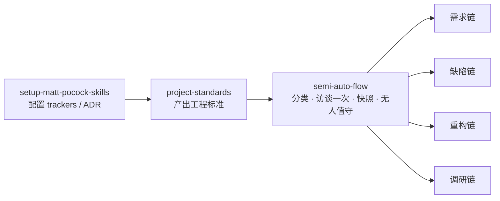

# Skills

个人工程工作流 skill 库。[mattpocock/skills](https://github.com/mattpocock/skills) 的 fork，origin 为 `opsbli/skills`。

共 36 个 skill，按用途分两个桶。skill 正文为英文（与上游及主流 agent 工具链保持一致），索引与说明见各桶的 README。

| 桶 | 数量 | 内容 |
|---|---|---|
| [engineering/](./engineering/README.md) | 27 | 日常编码工作流：需求澄清、规格、实现、评审、诊断、架构 |
| [productivity/](./productivity/README.md) | 9 | 通用工作流，与具体代码无关：访谈、交接、检索、写作 |

另有两个非 skill 目录：`docs/workflow.html`（工作流交互页）、`scripts/`（结构与副本一致性的校验器，以及校验器自己的变异测试）。改任何 skill 之前先读「[新增或修改一个 skill](#新增或修改一个-skill)」，那里的三处同步项和两道命令是硬要求，不是建议。

## 调用方式

每个 skill 是两种之一，这个选择决定 agent 能不能自己够到它：

- **model-invoked**：保留 `description`，agent 可自动触发，其他 skill 也能调用它。代价是描述常驻上下文（每轮都花 token）。
- **user-invoked**：设 `disable-model-invocation: true`。这个开关关掉的是「agent 能不能自己够到它」，不是描述本身 —— 本仓 19 个 user-invoked skill 全部保留 `description`，因为它在宿主的命令列表里是给人看的索引。**任何 skill 都调不动它**，需要人记住它的存在。省下的是触发权，描述是否仍占常驻上下文取决于宿主如何渲染该开关。

判断标准只有一条：**只有 agent 必须自己触发、或另一个 skill 必须调用它时，才做 model-invoked**。纯粹由人发起的动作留在 user-invoked：省下的是触发权，也省下描述可能带来的常驻开销。

## 工作流

分两层：前置层每个仓库跑一次，运行层每条请求都进入。



图里只画了四条链。`semi-auto-flow` 实际分 8 种类型，下表与它的类型表逐行对应 —— 路由、完成判据、是否访谈，一处定义，不要在两处各写一份：

| 类型 | 路由 | 完成判据 | 访谈 |
|---|---|---|---|
| 缺陷 | `diagnosing-bugs` → `code-review` → commit | 回归测试先红后绿、原复现不再出现、`[DEBUG-*]` 插桩已删 | 仅当证据还不足以支撑诊断 |
| 需求（单文件、单上下文） | 直接 `implement` | 该票 tdd 循环关闭，review 两轴通过 | 仅当命中「必须访谈」的信号 |
| 需求（跨文件） | `to-spec` → `to-tickets` → 逐票 `implement` → `code-review` | 每张票的 tdd 循环关闭，review 两轴通过 | **必有** |
| 重构 | `codebase-design` → `implement` → `code-review` | 行为不变（由 `verify-<app>` 证明），形态更小或更浅 | 仅当命中信号 |
| 调研 | `research` → 交给需求链 | 有带引用的文件，且被交给某条流程 | 否 |
| 收尾（活已做完，要求提交/验证/汇报） | 验证已有的：相关测试、类型检查，然后提交；改动大于版本号或纯文档时先 `code-review` | 测试与类型检查通过，且已提交 | 仅当范围确实不清 |
| 回答 | 直接回复 | 仓库不写入任何内容 | 否，答完即止 |
| 拿不准 | `ask-matt`，再回到本表 | 人选出类型 | 否 |

「必须访谈」的四个信号：术语未定义、决策无人可依（所在区域没有 ADR 且撤销代价高）、边界归属未定、证据不足。缺文件本身不算信号 —— 领域文档是懒创建的，新仓库本来就没有。

除「回答」外，所有类型都在当前分支提交，PR 正文用 `pr` 写。**不主动开 PR**：向外发布是这个流程唯一没有被取消的门，除非工作区的 `AGENTS.md` 明确授权。

完整路径见 [docs/workflow.html](./docs/workflow.html)：可切换的交互页，五栏分别是需求、缺陷、重构、调研，以及「收尾 · 回答 · 拿不准」。需求一栏把单文件与跨文件放在一起讲。

四个容易走错的点：

- `semi-auto-flow` 是入口，不是链上的一步。它负责分类、访谈一次、定风险、写快照、路由；主张是**只在前段跟人说话一次**（该访谈的类型访谈一次），之后不再停下确认 —— 不是把每一步的确认都取消。
- 访谈阶段它直接读 `grilling` + `domain-modeling`，**`grill-with-docs` 在门禁下不是一步**：`semi-auto-flow` 明说它只是个一行包装、加不了任何可加载内容。`grill-with-docs` 作为入口只适用于没有门禁的工作区。
- `implement` 与 `implement-spec` 是**替代关系**：数同时 ready 的票，1 张用前者，≥2 张且总票数 ≥4 才用后者。串行图里用后者是纯亏。
- 构建路径在 `to-tickets` **之后**决定，分类阶段拿不到任务图。

## 标准从哪来

`project-standards` 是前置层里真正的产出者，它按一个优先级取事实：

1. **有代码生成器** → 生成器的**模板**是规范源，产物即合规基线；生成器的**配置**是缺陷面（上游默认值常常不等于本项目实际），要单独审计并报为 P0。
2. **没有生成器** → 从代码规律归纳：多数派、最新派、稳定性，三取二才算高置信；单靠数量不算证据。

模板与已有标准冲突时以模板为准，规则改写为「模板基线 + 演进方向」，并记录裁定人。产出物是目标仓库的 `docs/agents/project-standards.md`，之后由 `implement` 在首次编辑前、`code-review` 的 Standards 轴在评审时读取。

## 新增或修改一个 skill

三处必须同步，缺一则失效：

| 位置 | 要求 |
|---|---|
| `SKILL.md` frontmatter | `name` 与目录名逐字一致；user-invoked 加 `disable-model-invocation: true` |
| `agents/openai.yaml` | `display_name` + `short_description`；user-invoked 加 `policy.allow_implicit_invocation: false` |
| 桶的 `README.md` | 在 User-invoked 或 Model-invoked 段加一条索引 |

改完跑校验，不要靠肉眼：

```bash
python scripts/check_consistency.py
```

它检查六件事：目录名与 `name` 全匹配且无重名、`disable-model-invocation` 与 `agents/openai.yaml` 的 `policy` 一一对应、桶 README 索引无遗漏无多余、顶层 README 的计数与实际一致、Proma 副本与本仓正文逐字一致（只允许 `version` 行不同）、以及副本必须带 `version` 字段。退出码非 0 即有违约。

**校验器本身也有变异测试。** 一个从不失败的检查和无检查无法区分，所以每条检查都必须能在预期缺陷上真的失败：

```bash
python scripts/test_check_consistency.py
```

十条变异覆盖上面六类检查（登记无理由、无 `proma_version` 基线、基线过期、登记过期、未登记漂移、副本缺 `version`、`name` ≠ 目录、索引漏项、user-invoked 与 yaml 不一致、顶层计数过期）。每条在临时副本里种一个缺陷，要求非 0 退出且消息指名该缺陷；前置 control 用例不加缺陷，必须 exit 0 —— control 不过，后面所有结果都无意义。

**有意不一致要登记**：某个 skill 的正文如果本仓与 Proma 副本**必须**不同，写进 `scripts/proma-divergence.yaml` 并给出理由（没有理由的条目视为违约），否则校验器会报成 drift。

登记的不是「例外」，而是一条判据：**宿主绑定语句由副本特化**。一个 skill 里凡是答案依赖运行时的句子（skills 目录在哪、有没有 Skill 工具），本仓必须写成运行时中立（因为它分发给多个宿主），副本则写到它自己那个宿主上（因为副本只在一个宿主里跑）。把中立措辞回灌给副本是把精确答案换成模糊答案，反过来把副本措辞抄回本仓是让本仓只在一种宿主里正确。两种都不做。

## 与 Proma 的集成

Proma 内置的 `apps/electron/default-skills/` 是本仓库部分 skill 的副本，用于新工作区的默认技能集。

**这个关系是双向的，不要假设本仓永远是上游。** 仓库层面的权威在这里（分桶、桶 README、`agents/openai.yaml`、version 策略、校验脚本）；内容层面谁先谁后，取决于**哪个宿主先撞上这个问题**。2026-10-20 至 10-22 的 `diagnosing-bugs`（7 节诊断纪律）、`semi-auto-flow`（取代 `dev-flow`）、以及两个 verification skill 的目录写法修正，都是先在 Proma 侧落地再回灌本仓的。反过来，本仓把它改成运行时中立后，副本比本仓更精确，此时**不该回灌** —— 见上一节的判据。

**副本必须带 `version` 字段**。Proma 的 `parseSkillVersion` 在缺字段时返回 `0.0.0`，与内置版本比较恒为 0，导致已安装工作区**永远不会收到更新**。因此每次改动副本都要升版本号，并与本仓库正文逐字一致（只允许 `version` 行不同，以及上节登记的宿主绑定语句）。

### 分歧 skill 为什么不共享版本号

Proma 的 `parseSkillVersion(sourcePath)` 比的是「内置副本 vs 工作区副本」，两者都在 Proma 内部 —— **本仓的 `version` 字段不是它的输入**。所以给两侧写同一个版本号是有害的：正文不同而版本相同，`compareSemver` 会判定「已是最新」，升级门失效，漂移被静默锁死。

因此本仓 36 个 skill 都不带 `version`，版本线只存在于副本。登记了分歧的 skill 额外记一个 `proma_version` 基线，由校验器守住它没有被悄悄移动：副本版本一变，说明那边动过手，这条登记必须重新裁定 —— 要么重新登记，要么删掉（正文重新一致时）。

## 工作区约定

- `.workbuddy/`：agent 状态与 memory 日志，本地留存，不入库。
- `.scratch/`：流程的临时产物（快照、票据、决策图），按人而异，不入库。
