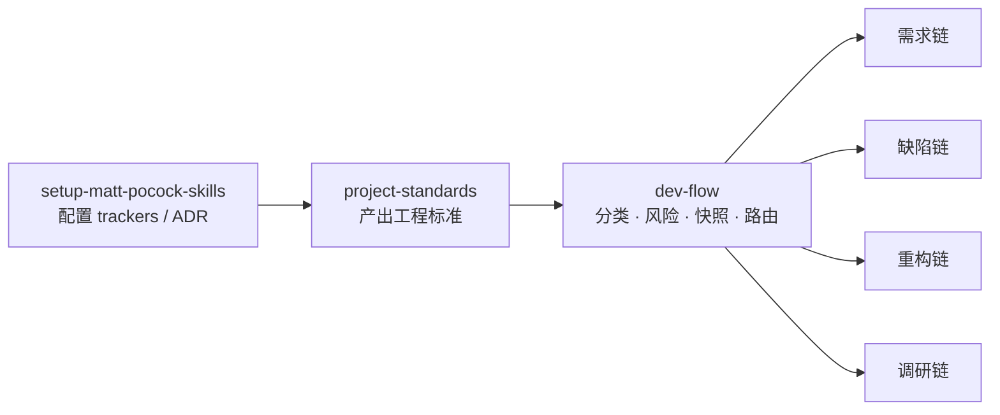

# Skills

个人工程工作流 skill 库。[mattpocock/skills](https://github.com/mattpocock/skills) 的 fork，origin 为 `opsbli/skills`。

共 36 个 skill，按用途分两个桶。skill 正文为英文（与上游及主流 agent 工具链保持一致），索引与说明见各桶的 README。

| 桶 | 数量 | 内容 |
|---|---|---|
| [engineering/](./engineering/README.md) | 27 | 日常编码工作流：需求澄清、规格、实现、评审、诊断、架构 |
| [productivity/](./productivity/README.md) | 9 | 通用工作流，与具体代码无关：访谈、交接、检索、写作 |

## 调用方式

每个 skill 是两种之一，这个选择决定 agent 能不能自己够到它：

- **model-invoked**：保留 `description`，agent 可自动触发，其他 skill 也能调用它。代价是描述常驻上下文（每轮都花 token）。
- **user-invoked**：设 `disable-model-invocation: true`，去掉 description。只有人敲命令才能触发，**任何 skill 都调不动它**。零上下文开销，但需要人记住它的存在。

判断标准只有一条：**只有 agent 必须自己触发、或另一个 skill 必须调用它时，才做 model-invoked**。纯粹由人发起的动作留在 user-invoked，省下常驻开销。

## 工作流

分两层：前置层每个仓库跑一次，运行层每条请求都进入。

四条链与完成判据：

| 类型 | 链路 | 完成判据 |
|---|---|---|
| 需求 | `grill-with-docs` → `to-spec` → `to-tickets` → `implement`/`implement-spec` → `code-review` → `pr` | 每张票的 tdd 循环关闭，review 两轴通过 |
| 缺陷 | `diagnosing-bugs` → `code-review` → commit | 回归测试先红后绿、原复现不再出现、调试插桩已删 |
| 重构 | `codebase-design` → `implement` → `code-review` | 行为不变（由 `verify-<app>` 证明），形态更小或更浅 |
| 调研 | `research` → 交给 `grill-with-docs` / `to-spec` | 有带引用的文件，且被交给某条流程 |
| 提问 | 直接回复 | 仓库不写入任何内容 |

完整路径见 [docs/workflow.html](./docs/workflow.html)（四条链可切换的交互页）。

三个容易走错的点：

- `dev-flow` 是入口，不是链上的一步。它只负责分类、定风险、写快照、路由。
- `implement` 与 `implement-spec` 是**替代关系**：数同时 ready 的票，1 张用前者，≥2 张且总票数 ≥4 才用后者。串行图里用后者是纯亏。
- 构建路径在 `to-tickets` **之后**决定，分类阶段拿不到任务图。

## 标准从哪来

`project-standards` 是前置层里真正的产出者，它按一个优先级取事实：

1. **有代码生成器** → 生成器的**模板**是规范源，产物即合规基线；生成器的**配置**是缺陷面（上游默认值常常不等于本项目实际），要单独审计并报为 P0。
2. **没有生成器** → 从代码规律归纳：多数派、最新派、稳定性，三取二才算高置信；单靠数量不算证据。

模板与已有标准冲突时以模板为准，规则改写为「模板基线 + 演进方向」，并记录裁定人。产出物是目标仓库的 `docs/agents/project-standards.md`，之后由 `implement` 在首次编辑前、`code-review` 的 Standards 轴在评审时读取。

## 新增或修改一个 skill

三处必须同步，缺一则失效：

| 位置 | 要求 |
|---|---|
| `SKILL.md` frontmatter | `name` 与目录名逐字一致；user-invoked 加 `disable-model-invocation: true` |
| `agents/openai.yaml` | `display_name` + `short_description`；user-invoked 加 `policy.allow_implicit_invocation: false` |
| 桶的 `README.md` | 在 User-invoked 或 Model-invoked 段加一条索引 |

改完跑一遍结构校验：目录名与 `name` 全匹配、无重名、调用方式与 yaml 一一对应、README 索引无遗漏。

## 与 Proma 的集成

Proma 内置的 `apps/electron/default-skills/` 是本仓库部分 skill 的副本，用于新工作区的默认技能集。

**副本必须带 `version` 字段**。Proma 的 `parseSkillVersion` 在缺字段时返回 `0.0.0`，与内置版本比较恒为 0，导致已安装工作区**永远不会收到更新**。因此每次改动副本都要升版本号，并与本仓库正文逐字一致（只允许 `version` 行不同）。

## 工作区约定

- `.workbuddy/`：agent 状态与 memory 日志，本地留存，不入库。
- `.scratch/`：流程的临时产物（快照、票据、决策图），按人而异，不入库。
